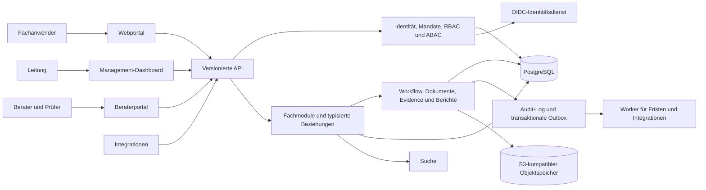
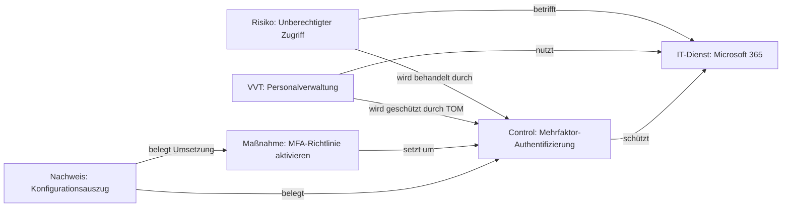

# D3 GRC · Plattformarchitektur

Der Produktkern verbindet Organisationsdaten mit Risiken, laufenden Kontrollen, Maßnahmen und Nachweisen. Eine Organisationseinheit und ein Asset können zugleich im Sicherheitsmanagement und im Datenschutz verwendet werden. Die Berechtigungsprüfung erfolgt für jede Nutzung des Objekts im jeweiligen Mandanten, Mandat und Organisationsbereich.

Als Referenz für die Fachlogik dient D3 GRC Desktop 0.10.0. Der Linux-Release-Build, 65 Regressionstests und die native Prüfung von Risikoverlauf, 5×5-Matrix und XLSX-Export sind dokumentiert. Die Anwendungen besitzen getrennte Speicherformate und Vertrauensmodelle. [Desktop-Prüfbericht 0.10.0](PRUEFBERICHT-0.10.0.md) · [Desktop-Prüfbericht 0.9.0](PRUEFBERICHT-0.9.0.md)

## 1. Zielarchitektur

| Baustein | Auftrag | Liefergrenze |
| --- | --- | --- |
| Webportal | Fachobjekte pflegen, Maßnahmen nachhalten, Quellen und Nachweise zuordnen. | Erste Arbeitsstrecke und gemeinsame Objektansichten im Plattformkern. |
| Management-Dashboard | Den belegten Stand und Handlungsbedarf je erlaubtem Organisationsbereich anzeigen, zu gefilterten Listen führen. | Anfangs Kennzahlen aus dem freigegebenen Datenbestand. Zeitreihen und Berichtsfreigabe folgen. |
| Beraterportal | Mandate auswählen und freigegebene Objekte bearbeiten oder prüfen. Verträge und Ablaufdaten gehören zum Mandat. | Mandatsprüfung ist Voraussetzung. Eine eigenständige mandatsübergreifende Oberfläche folgt. |
| Gemeinsame Dienste | Identität, Workflow, Dokumente, Evidence, Berichte, Audit-Log, Benachrichtigungen und Integrationen je Fachmodul wiederverwenden. | Der Plattformkern stellt Identität und fachliche CRUD- und Beziehungsoperationen bereit. Vollständige Workflow- und Dokumentendienste folgen. |
| Datenebene | PostgreSQL für transaktionale Fachdaten sowie Dateimetadaten, S3-kompatibler Speicher für Nutzdateien, PostgreSQL-Suche als Ausgangspunkt. | Audit und Outbox können dieselbe Transaktion nutzen. Event-Bus, separate Queue und speicherübergreifender Suchindex werden bei gemessenem Bedarf ergänzt. |

Der modulare Monolith bündelt Änderungen mit fachlichen Regeln in einer Transaktion. Fachmodule besitzen ihre Datenänderungen und veröffentlichen stabile IDs und Beziehungen. Das Portal nutzt die API unabhängig von der Oberfläche. Suche, Reports, Integrationen und Hintergrundaufträge erhalten dieselben Mandanten- und Bereichsgrenzen.

## 2. Fachmodule A–G

| Modul | Fachlicher Zielumfang | Desktop 0.10.0 und Plattformkern |
| --- | --- | --- |
| **A · Organisation und Governance** | Gesellschaften, Standorte und ein Organisationsbaum. Personen erhalten mehrere zeitlich und räumlich begrenzte Rollen. Richtlinien, Gremienentscheidungen, Ziele und Schulungen besitzen Verantwortliche und Nachweise. | Desktop bietet Unternehmensprofil, Plan und versionierte Dokumente. Die Plattform führt Organisationseinheiten, Mitgliedschaften und fachliche Personen. Dieselbe Person kann mehrere objektbezogene Verantwortlichkeiten übernehmen. Beschlüsse, Ziele, Schulungen und organisationsweite Dokumentenlenkung folgen. |
| **B · Enterprise Risk Management** | Risiken beschreiben Szenario, Ursachen, Auswirkungen, Geltungsbereich, Verantwortliche und Behandlung. Bewertungen hängen an einer bestimmten Version der Risikomethode und am fachlichen Stand des Szenarios. Kontrollen, Maßnahmen und Assets bleiben eigenständige Bezüge. | Desktop und Plattformkern erfassen Ausgangs- und Restrisiko, Risikobehandlung und einen Verlauf mit fester 5×5-Methode. Konfigurierbare, freigegebene Methodenprofile folgen. |
| **C · ISMS und IKS** | Assets und Dienste mit Abhängigkeiten und Schutzbedarf für Vertraulichkeit, Integrität und Verfügbarkeit pflegen. Dauerhafte Controls beschreiben Frequenz, Verantwortliche und Prüfnachweise. Maßnahmen sind terminierte Veränderungen. Die Erklärung zur Anwendbarkeit, kurz SoA, dokumentiert Auswahl und Ausnahmen. Planen, Umsetzen, Prüfen und Verbessern bildet den PDCA-Zyklus. | Desktop bietet thematische Controls, Audit-Kriterien, Evidence und Mappings. Die Plattform nutzt gemeinsame Assets, Controls und Maßnahmen. CIA-Bewertungen, Kontrollkalender, SoA, Kontrolltests und PDCA-Berichte folgen. |
| **D · Datenschutz** | Das Verzeichnis von Verarbeitungstätigkeiten (VVT) verbindet Zwecke, Kategorien, Rechtsgrundlagen, Systeme, Empfänger, Drittlandtransfers und Löschfristen. Technische und organisatorische Maßnahmen (TOM) referenzieren gemeinsame Controls. Eine Datenschutz-Folgenabschätzung (DSFA) führt eine Prüfung nach Art. 35 DSGVO durch und erfasst bei fortbestehendem hohem Risiko die vorherige Konsultation nach Art. 36 DSGVO als eigenen Vorgang. AVV, Betroffenenrechte, Datenschutzvorfälle, Aufbewahrung, Transferprüfungen und Audits erhalten eigene Abläufe. | Desktop bietet Quellen, Arbeitstexte, Anforderungen und Controls. Die Plattform nutzt Verarbeitungstätigkeiten mit eigenen Fachfeldern, gemeinsame TOM-Bezüge, separate DSFA-Datensätze und einen gefilterten Datenschutzbericht. Strukturierte Fallentscheidungen, Art.-36-Vorgang, Zuständigkeiten und Fristen der weiteren Fachworkflows folgen. |
| **E · Compliance** | Framework, Ausgabe und Anforderung mit unveränderlicher Version. Änderungen zwischen Ausgaben erscheinen als Diff für hinzugefügte, geänderte oder entfallene Anforderungen. Anwendbarkeit, Abdeckung und Ausnahmen werden fachlich freigegeben. Normtexte setzen passende Rechte voraus. | Desktop kennt Quellen, Vorlagen und begründete Zuordnung. Die Plattform erfasst Regelwerksfassungen als Katalogobjekte und typisierte Anforderungs- und Control-Bezüge. Unveränderliche Framework-Releases, Diff, Migrationsentscheidungen und Lizenzprüfung folgen. |
| **F · Audits und Evidence** | Auditprogramm mit Scope, Kriterienstand, Stichproben, Evidenz und Ergebnissen. Findings können Maßnahmen, Wirksamkeitsprüfung und Abschluss auslösen. Mehrere Controls und Audits dürfen dieselbe freigegebene Nachweisversion referenzieren. | Desktop prüft Nachweishash und Gültigkeit, hält den Kriterienstand fest und setzt Abschlussregeln durch. Der Plattformkern speichert begrenzte Dateinachweise und externe Verweise. Controls und Maßnahmen können denselben Nachweis im passenden Scope referenzieren. Versionierung, Quarantäne, Freigabe, Auditprogramm und Abschlussregeln folgen. |
| **G · Business Continuity Management** | Kritische Prozesse und Abhängigkeiten, Business-Impact-Analyse, Wiederanlaufziele und Datenverlusttoleranz, Notfallpläne, Übungen und Verbesserungen. | Im späteren Ausbau. Das fachliche Fundament aus Organisation, Assets, Risiken und Maßnahmen kann dabei weiterverwendet werden. |

Für Datenschutzworkflows sind die Fallprüfung und Freigabe durch die zuständigen Verantwortlichen maßgeblich. Die Plattform speichert Rechtsgrundlagen, Entscheidungen, dokumentierte Begründungen und Fristen in nachvollziehbarer Form. [Verordnung (EU) 2016/679](https://eur-lex.europa.eu/eli/reg/2016/679/oj)

### Regelwerk, Abdeckung und Prüfergebnis

| Quelle | Geplanter Katalogeintrag und fachliche Auswahl |
| --- | --- |
| ISO/IEC 27001:2022 und ISO/IEC 27002:2022 | Getrennte Fassungen für Anforderungen und Handlungsempfehlungen. Referenzen und eigene Arbeitstexte können einem ISMS-Geltungsbereich zugeordnet werden. Für lizenzierte Inhalte ist die Zugriffslizenz festzuhalten. |
| DSGVO und BDSG | Verordnung und nationale Rechtsgrundlage mit getrennter Fundstelle. Anwendbarkeit nach Verarbeitung, Organisation und Jurisdiktion beurteilen. |
| NIS2 und nationale Umsetzung | Europäische Richtlinie und je Land geltende Umsetzungsvorschriften getrennt erfassen. Nachweisbarer Stichtag und Unternehmensbereich steuern die Prüfung. |
| DORA | Anforderungen an IKT-Risikomanagement, Dienstleister, Vorfälle und Resilienz für den betroffenen Finanzsektor. |
| EU AI Act | Anforderungen im Kontext der Rolle der Organisation, des KI-Systems und der jeweils anwendbaren Frist. |
| BSI IT-Grundschutz | Kompendiumsausgabe, Bausteine und Anforderungsreferenzen mit begründetem Anwendungsbereich. |
| Interne Vorgaben und Verträge | Firma, Kunde, Vertragsfassung, Klausel, Geltungsbereich und Freigabestand getrennt festhalten. |

Das Zielmodell führt den Anforderungstext oder Quellenverweis je Ausgabe, die begründete Anwendbarkeitsentscheidung je Scope und den Umsetzungsstand des referenzierten Controls getrennt. Eine Zuordnung mit `mapping_type` vollständig, teilweise oder unterstützend beschreibt den erwarteten fachlichen Beitrag. Erst ein eigenes, versioniertes Prüfergebnis verbindet Anforderung, Control-Umsetzung und konkreten Nachweis. Eine neue Frameworkausgabe kopiert keine Freigabeentscheidung in die neue Ausgabe. Der erste Katalog besitzt Regelwerksfassungen, Anforderungen und begründete Beziehungen. Zuordnungstiefe, verbindliche Releases und Anwendbarkeits- sowie Prüfworkflows folgen. [BSI IT-Grundschutz](https://www.bsi.bund.de/grundschutz) · [NIS2](https://eur-lex.europa.eu/eli/dir/2022/2555/oj) · [DORA](https://eur-lex.europa.eu/eli/reg/2022/2554/oj) · [AI Act](https://eur-lex.europa.eu/eli/reg/2024/1689/oj) · [BDSG](https://www.gesetze-im-internet.de/bdsg_2018/)

### Methodenregister für ERM

Jede Methode besitzt eine Kennung, eine freigegebene Regelversion, Pflichtfelder, Skalen, Eingabegrenzen, eine Berechnungsfunktion und die Interpretation ihres Ergebnisses. Bewertungen frieren die verwendete Version mit Eingabewerten und Ergebnis ein. Ein Methodenwechsel erzeugt bei Bedarf eine weitere Bewertung. Ein Portfolio kann Werte nach derselben Methode und Regelversion aggregieren. Bei verschiedenen Methoden sind die Verteilung der Stufen und die behandlungsbedürftigen Einträge auszuweisen.

| Methode | Eingaben, die sie fachlich unterscheiden |
| --- | --- |
| Informationssicherheit | Auswirkung je Vertraulichkeit, Integrität und Verfügbarkeit. Das Profil legt fest, wie Schutzbedarf und Eintrittswahrscheinlichkeit in die Stufen einfließen. |
| Datenschutz | Eintritt und Schwere für die Rechte und Freiheiten betroffener Personen. Art der Verarbeitung, Personengruppen und Schutzmaßnahmen fließen in die Begründung ein. Die Bewertung ist im DSFA-Kontext separat nachvollziehbar. |
| Unternehmensrisiko | Auswirkungen auf Finanzen, Betrieb, Reputation und Strategie. Mandantenspezifische Skalen und Gewichtung bilden die freigegebenen Unternehmensmaßstäbe ab. |
| Lieferantenrisiko | Abhängigkeit, Ausfall, Sicherheit und Compliance. Ersatzmöglichkeiten, erbrachte Leistung, Vertragsbezug und Prüfergebnisse begründen das Profil. |
| Business Continuity | Ausfallzeit, Kritikalität und erwarteter Wiederanlauf. Daten aus der Business-Impact-Analyse und Übungen liefern Eingaben zur Bewertung. |

Die erste Matrix verwendet eine fest definierte Multiplikation von Eintritt und Auswirkung (je 1–5). Ausgangsrisiko, optionales Restrisiko und Maßnahmen werden getrennt erfasst. Eigene Skalen und die fünf fachlichen Profile brauchen das vollständige versionierte Methodenregister.

## 3. Gemeinsames Datenmodell

| Objekt | Identität und wichtigste Beziehungen |
| --- | --- |
| Mandant und Organisationseinheit | UUID für Mandant und Einheit. Jede fachliche Entität enthält `tenant_id`. Elternbeziehungen und Mitgliedschaftsgrenzen enthalten denselben Mandantenschlüssel. Zu den Schreibregeln gehört ein zyklenfreier Organisationsbaum. |
| Person, Konto, Mitgliedschaft, Rolle | Konten repräsentieren die technische Identität, Personen die fachliche Zuordnung. Eine Person kann mehrere Mitgliedschaften, Rollen und Geltungsbereiche besitzen. Externe Konten erhalten befristete Mandate mit eigenen Berechtigungen. |
| Fachobjekte | UUID, Mandant, optionaler Organisationsbereich, Titel, Zuständigkeit, Status und optimistische Versionsnummer. Spezifische Felder für Bewertung, Verarbeitung, Asset und Audit werden in eigenen Tabellen mit mandantengleichen Fremdschlüsseln gespeichert. |
| Typisierte Beziehungen | Beispielsweise `risk_asset`, `requirement_control`, `action_control`, Verarbeitung → Asset und Nachweis → Control. Typ, Richtung, fachliche Begründung und Eindeutigkeit gelten im Datenmodell. Datenbank und API validieren beide Endpunkte. |
| Versionen | Freigegebene Dokumente und Frameworks, Risikobewertungen sowie Audit-Kriterien bewahren konkret verwendete Fassungen. Anhänge besitzen Version, Größe, Medienart und Hash. Verknüpfungen können die stabile Objekt-ID oder eine bestimmte Version adressieren. |
| Ereignisse, Aufträge, Exporte | Ereignis-ID, actor ID, Mandant, Zeitpunkt, Aktion, Objekt, Korrelations-ID und Entstehungsgrund. Auftrags- und Exportzustand haben eigene UUIDs. Deduplizierung erfolgt pro Mandant und Operation. |

Eine gespeicherte Beziehung zwischen Asset und Verarbeitungstätigkeit hält die Referenz auf das Asset. Sicherheitsmanagement und Datenschutz können einen IT-Dienst ebenso gemeinsam referenzieren. Im Zielmodell kann eine Freigabe den fachlichen Stand einer TOM-Zuordnung festschreiben, während spätere Änderungen in der live gepflegten Assetansicht sichtbar bleiben.

Dieses Beispiel verwendet dieselbe UUID für Microsoft 365 in beiden Fachmodulen. Der Datenschutzbericht gibt die sichtbare Referenz auf den Dienst und den Control aus. Eine Control-Zuordnung belegt zunächst den fachlichen Zusammenhang. Prüfung, Wirksamkeit und Anwendbarkeit erhalten eigene Entscheidungen.

### Schema und Historie

- Mandantenübergreifend eindeutige UUIDs helfen bei Integrationen. Autorisierte Abfragen verwenden immer Mandant und Objekt-ID gemeinsam. Composite Unique Keys und Composite Foreign Keys verhindern Beziehungen zu ID-Kollisionen oder Objekten anderer Mandanten.
- Optimistische Versionen schützen aktive Datensätze vor verlorenen Änderungen. Stale Writes enden mit einem Konflikt und einem erneuten Laden des aktuellen Stands. Historische freigegebene Fassungen erhalten eigene Zeilen.
- Die Desktop-ID kann beim Import Teil einer Quellzuordnung werden. Ein zukünftiger Import speichert Quellpaket, Ursprungstyp, Ursprungsschlüssel und die erzeugte UUID. Das erlaubt eine wiederholbare Übernahme mit differenziertem Protokoll.
- Der Import einer verschlüsselten Desktop-Datei braucht einen separaten Auftrag mit privaten, kurzlebigen Arbeitsdateien und fachlicher Abnahme einer Kopie. Veröffentlichte Fassungen, Ergebnisse, Nachweisbytes und ihre Hashes werden unverändert zugeordnet. Historische lokale Profilkennungen bleiben als Herkunftsangabe erkennbar. Migrationen 005–009 betreffen das lokale SQLite-Schema. [Desktop-Dateiformat und lokale Identität](SICHERHEIT-UND-ABHAENGIGKEITEN.md) · [Desktop-Migration 009](../src/D3.Grc.Core/Migrations/009.sql)

## 4. Technologiestapel und Betrieb

| Ebene | Festlegung |
| --- | --- |
| Browser | React, TypeScript und eine responsive Oberfläche mit eigenem Design. Eine versionierte JSON-API trägt Nutzer- und Integrationszugriffe. |
| Backend | FastAPI mit Pydantic-Verträgen, Services pro Fachmodul und PostgreSQL. Schemaänderungen sind versioniert und kontrolliert wiederholbar. |
| Identität | Keycloak als vorgesehenes OIDC-Backend. Externe IdP wie Microsoft Entra ID werden angebunden. Die lokale Erprobung verwendet die mitgelieferte Session-Authentifizierung. |
| Dateien und Suche | S3-kompatibler Speicher dient später Datei- und Exportdaten. Anwendung, Uploadprüfung und Freigabe arbeiten über UUID-Metadaten. Suchindex und Cursor-Strategie wachsen mit Last und Datenmenge. |
| Aufträge | Transaktionale Outbox und idempotente Worker. Eine dedizierte Queue folgt bei Bedarf an Durchsatz, Verzögerung und Rückstau. |
| Deployment | Docker-Images, getrennte Konfiguration für Entwicklung, Test und Betrieb, TLS am Eintrittspunkt und in Produktionsverbindungen. OpenTelemetry für Anfragen, Aufgaben, Datenbankzeiten und Sicherheitsereignisse mit PII-sparsamem Logging. |

## 5. Mandant, Mandat und Berechtigungen

Mitgliedschaft und Mandat sind serverseitig an ein authentifiziertes Konto gebunden. Ein Mandat benennt Mandant, Umfang, erlaubte Rollen, frühesten Zugriff und Ablauf. Entzug und Fristende wirken bei der nächsten Prüfung. Eine Mitgliedschaft für mehrere Mandanten führt zu einem eindeutig ausgewählten aktiven Mandanten je Sitzung. Für Beraterportfolios sollen Kennzahlen pro verbleibendem Mandat getrennt abgefragt werden.

### Zielrollen und Actions

Rollenzuordnungen gelten für den zugewiesenen Mandanten und Bereich. Jede Aktion prüft zusätzlich Objektstatus, Vertraulichkeit, konkrete Zuständigkeit und gegebenenfalls Mandatsablauf. Technischer Betrieb hat standardmäßig keinen Zugriff auf Fachdaten. Ein zeitlich genehmigter Supportzugriff ist als separates Betriebskonzept vorzusehen.

| Fachrolle | Typische Rechte im freigegebenen Bereich |
| --- | --- |
| Platform Administrator | Plattformbetrieb, technische Mandantenaktivierung und Infrastruktur. Fachzugriff erfordert eine separat genehmigte, befristete Berechtigung. |
| Tenant Administrator | Mandant, Organisationsbaum und Mitgliedschaften verwalten. Fachzugriff folgt aus zusätzlich zugewiesenen Fachrollen. |
| Compliance Manager | Frameworks und Anwendbarkeit pflegen, Compliance-Freigaben und Reports im zugewiesenen Bereich koordinieren. |
| ISMS Manager | Assets, CIA und SoA pflegen, Sicherheitsprüfungen koordinieren und berechtigte Reports erstellen. |
| Privacy Manager/DSB | Datenschutzregister und DSFA bearbeiten, zugewiesene Fälle einsehen, prüfen und beraten. Die Organisation pflegt die fachlich zuständige Entscheidung separat von der Prüfrolle. |
| Risk Owner | Zugewiesene Risiken bearbeiten, bewerten und Behandlungsvorschläge dokumentieren. |
| Control Owner | Zugewiesene Controls und Maßnahmen umsetzen, Evidenz bereitstellen und Prüfinformation ergänzen. |
| Auditor | Audit-Scope und Tests pflegen, freigegebene Nachweise lesen, Findings und Ergebnisse dokumentieren. |
| Management | Aggregierte Cockpits lesen, Ziele und Zuständigkeiten im Geschäftsbereich steuern, zugewiesene Freigaben ausüben. |
| Read-only | Ausgewählte Fachobjekte und freigegebene Berichte lesen. Export und Sichtbarkeit vertraulicher Inhalte benötigen eigene Actions. |

Beraterkonten erhalten diese Fachrollen über ein Mandat. Die technische Zuordnung der ersten Runtime-Rollen steht bei den Implementierungsartefakten in Abschnitt 13.

### ABAC und Durchsetzung

1. Das Backend authentifiziert die Sitzung und ermittelt den zugewiesenen Mandanten und die gültige Mitgliedschaft. Ein vom Browser gelieferter Objekt- oder Mandantenschlüssel wird nur als Eingabe für die Autorisierungsprüfung verwendet.
2. Eine aktive Rollenzuordnung muss die Action erlauben. Explizite Einschränkungen für vertrauliche Bereiche, Objekttyp und Status schränken den Zugriff weiter ein. Eigentümerschaft und Verantwortlichkeit gewähren Rechte nur innerhalb einer dafür vorgesehenen Policy.
3. Der Organisationsbereich muss von der Rollenzuordnung oder vom Mandat abgedeckt sein. Leselisten, Zählungen, Suche, Join-Operationen, Einzelansicht und Export verwenden dieselbe Filterung. Beziehungserstellung prüft Quelle und Ziel.
4. PostgreSQL verwendet Row-Level Security für Mandantentabellen und transaktionslokalen Zugriffskontext. Runtime-Rollen erhalten minimale DML-Rechte, weder Schemaeigentum noch `BYPASSRLS`. Exportworker, Indexer und Jobs übernehmen einen neu geprüften Kontext.
5. Zugriffsversuche, Änderungen von Rollen und Mandaten sowie sicherheitsrelevante Aktionen werden mit Actor-ID, Ergebnis und Korrelations-ID erfasst. SIEM-Anbindung, externe Signatur oder Archivierung dürfen erst nach der betrieblichen Abnahme zugesichert werden.

### Schutz und Datenlebenszyklus

- TLS für Transport, verwaltete Schlüssel mit Rotation für Datenbank, Dateien und Backups. Betriebszugänge verwenden getrennte Identitäten, kurze Laufzeiten und soweit möglich MFA. Geheime Werte kommen zur Laufzeit aus der vorgesehenen Secret-Verwaltung.
- Dateien werden größen- und formatbegrenzt angenommen, gehasht und vor Freigabe in Quarantäne gescannt. Downloads prüfen Tenant, Bereich, Vertraulichkeit und Freigabestand. Dateinamen sind Anzeigewerte. Der Dienst vergibt die Speicherpfade.
- Aufbewahrung und Löschung werden je Objektart, Mandant und Rechtsgrundlage konfiguriert. Ein dokumentierter Legal Hold setzt den planmäßigen Löschjob für betroffene Objekte aus. Freigabehistorien, Referenzen, Suchindex, Exportdateien und Auslauf von Backups sind in Löschkonzept und Abnahme einzubeziehen. Wiederhergestellte Backups werden vor Freigabe mit Sperr- und Löschentscheidungen abgeglichen.
- Datenbank- und Objektsicherungen werden regelmäßig in einer getrennten Umgebung wiederhergestellt. Die Abnahme umfasst Point-in-Time-Wiederherstellung, Zuordnung und Hashprüfung von Dateien, Sichtbarkeit je Mandant und gemessene RPO- und RTO-Werte.
- CI überprüft Builds, Tests, Migrationen, Abhängigkeiten, Lizenzen, Secret-Leaks und Containerimages. Kontrollierte Rollouts, Schlüsselrotation, Restore-Proben und Berechtigungstests sind Betriebsaufgaben mit Verantwortlichen und Termin.
- Für einen Betriebsanbieter werden Datenstandort, Auftragsverarbeitung, Unterauftragnehmer, Schlüsselzugriff, Exportmöglichkeiten und Wiederherstellungsfristen vorab geklärt. Der lokal startbare Plattformkern legt keinen Hostinganbieter fest.

## 6. API und Integrationen

Alle Fach- und Integrationsoperationen folgen denselben Autorisierungsregeln. Die API versioniert öffentliche JSON-Verträge. HTTP-Antworten unterscheiden fehlende Anmeldung, fehlende Rechte, nicht sichtbares Objekt, ungültige Eingabe und konkurrierende Objektversion. Listen nutzen stabile Sortierung und begrenzte Seitengröße. Aufträge erhalten Korrelations-ID und mandantenbezogenen Idempotenzschlüssel. Logfelder enthalten nur den für Betrieb und Nachvollziehbarkeit erforderlichen Kontext.

| Priorität | Anbindung | Abnahme |
| --- | --- | --- |
| P1 | Entra ID, SMTP, Excel und öffentlich dokumentierte API | Eindeutige Konto- und Mandantenzuordnung, nachvollziehbarer Versand mit Zustellfehlern, validierte Excel-Felder und dokumentierte HTTP-Verträge. Der Plattformkern startet mit eigener Sitzungsanmeldung und JSON-API. |
| P2 | Microsoft Graph, Intune, LDAP und Webhooks | Lesend beginnen, Quellobjekte stabil zuordnen, selektive Felder synchronisieren. Webhook-Signatur, Ablaufgrenze, Wiederholungen und Fehlerwarteschlange werden je Mandant konfiguriert. |
| P3 | Defender, Purview, Jira und Wazuh | Befunde auf erlaubte Assets und Maßnahmen abbilden. Operatoren prüfen den Status der Verbindung und den letzten erfolgreichen Import. Gezielter Rückkanal folgt nach Rechte- und Datenflussabnahme. |

Connector-Konfiguration enthält Zuständigkeit, Feldmapping, erlaubte Ziele, Credentials-Referenz, Synchronisationscursor und Lebenszyklus. Synchronisationsläufe prüfen Berechtigungen und aktuelle Reichweite erneut. Duplikate werden anhand einer tenant-spezifischen Quellkennung erkannt. Fachliche Konflikte landen in einer Prüfliste.

## 7. Workflows und Wiedervorlage

| Vorgang | Zustände und Folgearbeit |
| --- | --- |
| Risiko und Maßnahme | Risiko erfassen und bewerten, Behandlung auswählen, Maßnahmen mit Zuständigkeit und Frist zuordnen, Wirksamkeit nachweisen und Restrisiko neu bewerten. Der Verlauf enthält je Bewertung Methode, Eingaben, Ergebnis und Begründung. |
| Dauerhafte Kontrolle | Geltungsbereich und Frequenz bestimmen, erwartete Evidenz beschreiben, Prüfaufgabe erzeugen, Ergebnis beurteilen, Abweichung als Finding und Maßnahme weiterführen. |
| Dokument oder Framework | Entwurf, Prüfung, Freigabe und Veröffentlichung. Eine Revision verknüpft neue Entwurfs- und veröffentlichte Version. Reviewer, Datum, Gründe und Abweichungsentscheidungen bleiben abrufbar. |
| Lieferant und Datenschutz | Leistung, Kritikalität und Datenzugriff erfassen. VVT, TOM, Vertrag und Bewertung verknüpfen. Wiedervorlage nach Risiko, Vertragslaufzeit und Mandantenpolicy. |
| Audit und Incident | Prüfziel oder Vorfall erfassen, Betroffenheit ermitteln, Nachweise und Maßnahmen zuordnen, Freigaben sowie gesetzliche und interne Fristen dokumentieren, Abschluss begründen. |

Wiedervorlagen und Eskalationen hängen an fachlichem Ereignis, Fälligkeit, Zeitzone und Empfängerrolle. Ein Arbeitsauftrag wird in derselben Transaktion vorgemerkt wie das auslösende Ereignis. Worker behandeln Wiederholungen und Freigabe vor Benachrichtigung. Ihre Zustellung schreibt einen deduplizierten Versuch mit Ergebnis. Die UI zeigt eigene Aufgaben, überfällige Vorgänge und gescheiterte Zustellung anhand gespeicherter Daten.

Im Plattformkern werden Fachobjektzustände und Historie einzelner Operationen gespeichert. Termine, mehrstufige Freigaben, Vier-Augen-Policies, Regel-Editor und Nachrichtenzustellung sind eigene Ausbaustufen.

## 8. Rollenbezogene Cockpits

| Zielgruppe | Kennzahlen und Einstieg |
| --- | --- |
| Management | Bewertete Ausgangs- und Restrisiken, behandlungsbedürftige Risiken, offene priorisierte Maßnahmen und fällige Prüfungen. Filter nach erlaubtem Organisationsbereich. |
| Fachverantwortung | Zugewiesene Risikobewertungen, Controls ohne gültigen Nachweis, fällige Maßnahmen und eigene Prüfaufgaben. |
| Informationssicherheit und Datenschutz | Asset- und VVT-Abdeckung, Prüf- und Löschfristen, offene Schutzmaßnahmen und sichtbare Incident-Vorgänge. |
| Audit und Beratung | Freigegebene Audit- und Evidence-Stände, Abweichungen und Maßnahmen im jeweiligen Auftrag oder Mandat. |

Kennzahlen nennen Basis und Filter. Beispielsweise zählt ein kritisches Restrisiko nur bei vorhandener Restrisikobewertung. Ein leerer Bereich erhält einen Leerzustand. Fehlende Bewertungen bleiben als offen erkennbar. Drill-down verwendet dieselbe Menge wie die Kennzahl und zeigt die betreffenden Datensätze. Berichte halten Erstellungszeitpunkt, Filter, zulässigen Bereich und die berücksichtigten fachlichen Versionen fest. Aggregate vertraulicher Bereiche werden ebenfalls autorisiert.

Die Übersicht in 0.11.0 zeigt Registerzahlen, vorhandene und ältere Risikobewertungen, erfasste und abgelaufene Nachweise sowie Controls ohne aktuell gültigen Nachweis. Der Einstieg schlägt die Anlage des ersten fehlenden Registers im ausgewählten Bereich vor. Ein späterer Einrichtungsassistent kann aus Organisationsprofil, Branche, Größe und Zuständigkeiten einen begründeten Umsetzungsplan ableiten. Die Statistik zu Nachweisen beschreibt den erfassten Bestand und seine Gültigkeit. Die Prüfung der Konformität erhält ein eigenes Ergebnis.

## 9. Roadmap

| Phase | Reihenfolge und Freigabepunkt |
| --- | --- |
| 1a · Gemeinsamer Datenpfad | Mandant → Organisation → Asset → Risiko → Control → Maßnahme → Evidence → Dashboard. Pro Schritt eine sichtbare Arbeitsaktion, gemeinsame Objekt-IDs, Datenbank-Isolation und Beziehungsprüfung. |
| 1b · Datenschutzpfad | Dasselbe Asset → VVT → gemeinsam genutzter Control als TOM → gefilterter Bericht. Rechteprüfung und Verknüpfungsnachweis über beide Fachsichten. Separate DSFA-Grundlage anschließend fachlich vervollständigen. |
| 2 · Workflow, Prüfung und Betrieb | Versionierte Risikomethoden, freigegebene Frameworkreleases und Diffs, Incident und Fristen, Evidence-Objektspeicher, Auditprogramm, belastbare Wiederherstellung und OIDC. Integrationen nach P1/P2/P3, mit eigener Betriebsabnahme. |
| 3 · Produktbetrieb und BCM | Beraterportfolio, Paketverwaltung, produktionsreife Mandantensicherheit, Schulungen, Audit- und Berichtsprogramme sowie BCM mit Übungen und Wiederanlaufplanung. |

Der priorisierte, testbare Arbeitsvorrat führt Abhängigkeiten und Freigabepunkte je Phase. [Plattform-Backlog](PLATTFORM-BACKLOG.md)

## 10. Akzeptanz und Betriebsreife

| Fall | Beobachtbares Ergebnis |
| --- | --- |
| 1 · Zwei Mandanten | Identische Suchwerte in zwei Mandanten bleiben bei Listen, direkten IDs, Beziehungen, Evidence und Reports isoliert. Ein autorisierter Zugriff in Mandant A verändert Daten in Mandant A. |
| 2 · Entzogenes Mandat | Mandat gewährt anfangs Zugriff im vereinbarten Bereich. Nach Entzug oder Ablauf verweigert dieselbe Sitzung weitere Zugriffe. Ein bestehender Exportauftrag prüft die Berechtigung vor Übergabe erneut. |
| 3 · Risikohistorie | Eine ältere Bewertung und die verwendete Methode bleiben nach neuer Bewertung oder geänderter Methode identisch abrufbar. Fehlendes Restrisiko bleibt leer. |
| 4 · Frameworkhistorie | Neue Ausgabe zeigt Diff und Freigabebedarf. Frühere Anwendungsentscheidungen und Reports beziehen sich weiterhin auf die vorherige Ausgabe. |
| 5 · Nachweis ersetzt | Neue Datei erhält eigene Version. Ältere Nachweisversion bleibt nach Aufbewahrungspolicy für historische Prüfungen abrufbar. Ein gesperrter oder gelöschter Inhalt folgt der eingestellten Aufbewahrungsentscheidung. |
| 6 · Gemeinsamer Control | Asset und Control haben in ISMS und VVT/TOM jeweils dieselbe Objekt-ID. Der fachliche Bezug ist pro Kontext getrennt sichtbar und referenziert die richtige Version, sobald er freigegeben wird. |
| 7 · Gefilterter Bericht | Bericht und Cockpit treffen dieselben erlaubten Filterentscheidungen. Fremde oder vertrauliche Objekte erscheinen weder in Details noch in Zählwerten. |
| 8 · Wiederholter Auftrag | Abgebrochene oder wiederholte Anfrage erzeugt höchstens eine beabsichtigte Änderung und einen fachlichen Journaleintrag. Nicht zustellbare Nachrichten wechseln nachvollziehbar in die Fehlerwarteschlange. |
| 9 · Wiederherstellung | Eine gesicherte Testumgebung wird innerhalb der vereinbarten Fristen wiederhergestellt. Tabellen, Datei-Hash und erlaubte Mandantensicht werden überprüft. |
| 10 · Incident | Betroffenheit, Zuständigkeit, Risiko für Betroffene, Entscheidung zur Meldung, Fristen und aktualisierte Folgeaufgaben bleiben prüfbar. Abschluss hat einen verantwortlichen Actor und dokumentierte Begründung. |

Die Tests werden gegen zwei Mandanten, mindestens zwei Organisationsbereiche, abgelaufene und aktive Mandate sowie direkte und indirekte Beziehungen gefahren. Reine Schema- oder Browsernavigation zählt als Vorprüfung. Betriebsfälle erfordern die tatsächliche Datenbank, Speicherung, Auftragslauf und Restore. [Prüfaufträge und Status](PLATTFORM-BACKLOG.md)

## 11. Funktionen, Pakete und Shop

| Angebot | Vorgesehene Aktivierung |
| --- | --- |
| Privacy | Datenschutzregister, VVT, TOM, DSFA und Datenschutzworkflows. |
| Security | ISMS, Assets, Sicherheitsrisiken, Kontrolle, Maßnahmen und Auditvorbereitung. |
| Compliance | Frameworks, Anwendbarkeit, Mapping, Prüfungen und Compliance-Reporting. |
| Complete | Gebündelte Module mit gemeinsamem Datenmodell und übergreifenden Cockpits. |
| Partner | Beratungsaktivitäten und mandatsabhängige Portfoliosteuerung für mehrere Unternehmen. |

Ein Angebot beschreibt die aktivierbaren Funktionen. `Entitlement(tenant_id, feature_key, valid_from, valid_until, source_id)` hält den gültigen Funktionsumfang serverseitig fest. Die Berechtigungsprüfung erfordert zusätzlich die Rolle, erlaubten Bereich, Mandatsbedingungen und Objektpolicy. Webportal, API und Hintergrundaufträge prüfen diese Voraussetzungen gemeinsam. Ein späterer Shop schreibt Zahlungs- und Bestellereignisse getrennt von Fachdaten. Geplante Paketwechsel brauchen eine klare Regel für Lesezugriff, Export und Aufbewahrung. Shop, Abrechnung und Lizenzprüfung sind Ausbaustufen.

Urheberrecht, Verträge und Namensrechte bestimmen freigegebene Inhalte. D3 GRC nutzt eigene Oberflächen, Arbeitstexte und Quellenverweise. Gebührenpflichtige Normtexte oder Kataloge werden erst nach geklärter Zugangs-, Speicher-, Übersetzungs- und Weitergabelizenz freigeschaltet. Rechtsverweise und technische Statusmeldungen ersetzen keine fachliche Prüfung eines Einzelfalls. Drittanbieter-Benchmarks dienen als Produktreferenz. Die vollständige Zuordnung zum Swiss-GRC-Angebot konnte wegen des Proxy-Zugriffs in der bisherigen Abnahme nicht geprüft werden. [Drittanbieterhinweise](../THIRD-PARTY-NOTICES.md) · [ISO-Copyright](https://www.iso.org/copyright.html) · [Swiss GRC Plattform](https://swissgrc.com/plattform/)

## 12. Architekturentscheidungen

| Entscheidung | Begründung und Folge |
| --- | --- |
| Modularer Monolith für die erste Plattform | Fachliche Änderung, Version, Audit und Outbox können in einer Transaktion festgeschrieben werden. Modulschnittstellen halten spätere Auslagerung von I/O-intensiven Komponenten offen. |
| PostgreSQL mit zusammengesetzten Beziehungen und RLS | Tenant- und Scope-Prüfungen gelten auch für Join- und Hintergrundzugriffe. SQL-Migrationen, Rollen und Scope-Regeln werden gemeinsam abgenommen. |
| Gemeinsamer Objektkern mit Fachdetails | Reale Einheit, Asset, Control und Nachweis bleiben fachübergreifend referenzierbar. Eigene Fachtabellen und Freigaben schützen die jeweiligen fachlichen Besonderheiten. |
| API-first mit serverseitiger Autorisierung | Frontend und Integrationen teilen versionierte Verträge. Sichtbare UI-Elemente führen zu zugelassenen Aktionen, während Backend und Datenbank die Grenzen durchsetzen. |
| Historische Versionen und fachlich begründete Beziehungen | Alte Berichte bleiben nachvollziehbar. Freigabe, Gültigkeitszeit und Löschfreigabe werden je Typ modelliert. |
| Entitlements zusätzlich zu Rollen | Paketwechsel, Rollout und Personenzugriff bleiben unabhängig prüfbar. Einführung eines Shops verändert keine Fachdatenberechtigungen. |
| Expliziter Desktop-Import | Ein separat geprüfter Fachimport löst Konflikte, Quellidentitäten und Autorenschaft nachvollziehbar. Linux-Desktopabnahme und Plattformabnahme haben eigenständige Nachweise. |
| Betriebszusagen nach Abnahme | SSO, Malware-Prüfung, Restore, Schlüsselrotation und Plattform-Rollen erfordern Integrations- und Betriebstests. Dokumente nennen den jeweils belegten Funktionsstand. |

## 13. Implementierungsartefakte

### PostgreSQL und Zugriffspfad

| Artefakt | Tabellen und garantierte Regeln |
| --- | --- |
| [001_identity.sql](../platform/backend/migrations/001_identity.sql) | `tenants`, `members`, `sessions`, `advisor_mandates` und `audit_events`. Tenant- und Member-Referenzen, Ablauf und Entzug, erzwungene RLS und eng begrenzte Authentifizierungsfunktionen. |
| [002_domain.sql](../platform/backend/migrations/002_domain.sql) | `catalog_records` mit typisierten UUID-Objekten, `catalog_dpias` für DSFA-Fachfelder sowie `catalog_link_types` und `catalog_links`. Typ, Mandant und Scope beider Link-Endpunkte bilden zusammengesetzte Referenzen. |
| [003_operations.sql](../platform/backend/migrations/003_operations.sql) | `risk_assessments`, `evidence_items` und `evidence_links`. Risikobewertungen sind append-only. Datenbank berechnet Bewertungsprodukte, Dateigröße und SHA-256. Nachweise werden mit Controls im passenden Scope verknüpft. |
| [004_imports.sql](../platform/backend/migrations/004_imports.sql) | `catalog_imports` speichert Ergebnis und Fingerabdruck je Mandant, Actor und Importschlüssel. Die Wiederholung erfolgt in Verbindung mit der fachlichen Scope-Prüfung. |
| [005_responsibilities.sql](../platform/backend/migrations/005_responsibilities.sql) | `organization_people` hält fachliche Personen im eigenen Mandanten. `organization_responsibilities` verknüpft eine Person mit einem typgeprüften Ziel. Eine aktive Kombination von Person, Ziel und Rolle ist eindeutig. Widerruf erhält die historische Zuordnung. |
| [006_shared_service_links.sql](../platform/backend/migrations/006_shared_service_links.sql) | Direkte typisierte Bezüge zwischen Verarbeitung und IT-Dienst, Control und IT-Dienst sowie Risiko und Verarbeitung. Die Beziehungen verwenden die mandantenbezogenen Fremdschlüssel des Katalogs. |
| [007_evidence_measures.sql](../platform/backend/migrations/007_evidence_measures.sql) und [008_evidence_target_required.sql](../platform/backend/migrations/008_evidence_target_required.sql) | `evidence_links` erfasst verpflichtend den Zieltyp `control` oder `measure`. Die vorhandenen Fremdschlüssel sichern den Zieltyp und einen gemeinsamen Mandanten und Scope. |

Der Migrator verwendet eine Transaktionssperre und registriert Dateiname, Prüfsumme und Zeitpunkt in `schema_migrations`. Nach dem Start arbeitet die API mit `grc_runtime` unter einem unprivilegierten separaten Login. Für die Session-Auflösung gibt es eng definierte Funktionen unter `grc_authenticator`. Die Aktivierung des Mandanten und seiner erlaubten Scopes erfolgt transaktionslokal. [Migrations- und Runtime-Code](../platform/backend/app/db.py) · [Container-Start](../platform/backend/app/deployment.py)

| Beziehung | Kardinalität und Datenbankgrenze im ersten Stand |
| --- | --- |
| Mandant → Mitglieder → Sitzungen | Ein Mandant hat mehrere Mitglieder. E-Mail-Adressen sind je Mandant eindeutig. Sitzungen haben einen mandantengleichen Mitgliedsbezug, eindeutigen Token-Hash und Ablauf. |
| Organisationseinheit → Fachobjekte | Ein Fachobjekt kann einer Einheit zugeordnet werden. Bei einer Organisationseinheit repräsentiert das Feld die übergeordnete Einheit. Der Fremdschlüssel verlangt denselben Mandanten und den Typ `org_unit`. Die API prüft Zyklen unter Transaktionssperre. |
| Fachobjekt → DSFA-Fachfelder oder Bewertungsverlauf | Je DSFA eine Fachzeile mit mandanten-, typ- und scopegleichem Verweis. Je Risiko mehrere unveränderliche Bewertungszeilen. Das optionale Restrisiko enthält entweder beide Skalenwerte oder keine. |
| Fachobjekt ↔ Fachobjekt | Pro zulässigem Beziehungstyp kann dieselbe gerichtete Verknüpfung einmal vorkommen. Zwei Fremdschlüssel sichern jeweils Tenant, UUID, Typ und Scope. Beide Endpunkte unterliegen der Zugriffsprüfung. |
| Person ↔ fachliches Ziel | Eine Person kann mehrere fachliche Rollen an mehreren Zielen besitzen. Der zusammengesetzte Fremdschlüssel sichert den Zieltyp. Eine Datenbankregel prüft die erlaubte Kombination aus Rolle und Typ. |
| Nachweis ↔ Fachobjekt | Ein Nachweis kann mit mehreren fachlichen Zielen im selben Scope verbunden sein. Fremdschlüssel sichern Mandant, Scope und Zieltyp. Dateigröße und Dateihash werden aus dem gespeicherten Inhalt abgeleitet. |
| Änderung → Audit-Log und Importwiederholung | Jede Auditzeile enthält den Bezug auf das handelnde Mitglied desselben Mandanten. Die Anwendungsrolle darf Auditzeilen lesen oder anlegen, sofern ihre Policy das erlaubt. Importwiederholungen sind pro Mandant, Mitglied und Schlüssel eindeutig. |

Das API-Datenbankkonto und der vom Backend gesetzte Kontext bilden eine Vertrauensgrenze. Die personengebundene Autorisierung findet vor dem Setzen der Transaktionsparameter statt. Der Datenbank-Login gehört in die Serverkonfiguration. Die gespeicherte Verantwortung, der Organisationsbaum und der Scope-Text sind im ersten Stand getrennte Konzepte.

Die nächsten Schemaänderungen erhalten eigene Migrationen. Ihre fachlichen Fremdschlüssel beziehen den Mandanten mit ein. Laufende Freigaben referenzieren stabile UUIDs, historische Vorgänge zusätzlich die konkret verwendete Version.

| Geplante Schemaerweiterung | Schlüssel und Regeln |
| --- | --- |
| Kontoföderation und Rollen | `identities(issuer, subject)` identifiziert Konten eines OIDC-Anbieters. `memberships(tenant_id, person_id, account_id)` ordnet fachliche Personen zu. `role_grants` verbindet Mitgliedschaft, Rolle, Organisationsbereich und Gültigkeitsintervall. `entitlements` verwaltet davon getrennt Funktionskennungen und Vertragslaufzeit. |
| Methoden und Risikohistorie | `risk_method_versions(tenant_id, method_key, version)` identifiziert eine freigegebene Skala und Berechnung. Neue Bewertungssnapshots tragen Methodenreferenz, Risikostand, Eingaben, Ergebnis und Begründung. Historische Zeilen behandeln Zeit und Regelversion separat. |
| Frameworks und Dokumente | `framework_releases(tenant_id, framework_id, version)` und `document_versions(tenant_id, document_id, version)` halten Freigabe, Veröffentlichungsdatum und Fachinhalt fest. Ein Anforderungssnapshot verbindet releaseübergreifende Anforderungskennung mit genau einer Ausgabe. Normlizenz und erlaubter Empfängerkreis werden am Release geprüft. |
| Anwendbarkeit und Prüfstand | `requirement_applicability` verbindet Version und Geltungsbereich mit Entscheidung, Begründung und Freigabe. `requirement_control_mappings` hält Typ der Abdeckung und die referenzierte Control-Implementierung. `assessment_results` verbindet Prüfergebnis und freigegebene Evidence. Die Fremdschlüssel beziehen den Mandanten und den konkreten Versionsstand mit ein. |
| Umsetzung und Wirksamkeit | `control_implementations(tenant_id, control_id, scope_id)` erlaubt je Control getrennte Umsetzungen pro Bereich. `action_control` verbindet die Umsetzung mit mehreren Maßnahmen. Kontrolltests referenzieren eine konkrete Umsetzung, Bewertungsstand und freigegebene Nachweisversion. |
| Überprüfbare Evidence | `evidence_versions(tenant_id, evidence_id, version)` bindet unveränderliche Speicherkennung, SHA-256, Erhebung, Gültigkeitszeit und Freigabe zusammen. Audit- und Control-Tests referenzieren genau diese Version. `retention_policies` und `legal_holds` steuern Löschzeit und Ausnahmen. |
| Datenschutz-, Audit- und BCM-Workflows | Fälle referenzieren typisierte Grundobjekte und speichern ihren eigenen fachlichen Zustand. `dpia_consultations` referenziert eine DSFA mit verantwortlicher Stelle und Verfahrensdaten. `audit_tests` referenziert eingefrorene Kriterien und Evidence. BCM-Übungen referenzieren den veröffentlichten Plan und dokumentieren Verbesserungen. |
| Aufträge und importierte Identitäten | `outbox_events(tenant_id, event_id)` und `job_attempts(tenant_id, event_id, destination, attempt_no)` verbinden Zustellung und Wiederholung. Ein Importregister ordnet `(tenant_id, source_instance, source_kind, source_key)` der Ziel-UUID zu. Hash und fachliche Quellversion erleichtern Konfliktprüfung und Wiederholung. |

### RBAC und ABAC im Plattformkern

| Runtime-Rolle | Rechte und Nähe zum Zielrollenmodell |
| --- | --- |
| `admin` | Fachrechte sowie `iam.manage` und `audit.read` im eigenen Mandanten. Entspricht dem Einstieg für Tenant Administrator mit zusätzlichen Fachrechten bis zur feineren Trennung. |
| `member` | Lesen und Ändern von Katalog, Bewertungen und Nachweisen sowie `exports.read` und `audit.read` im eigenen Mandanten. Getrennte Compliance-, ISMS-, Privacy-, Risk- und Control-Rechte brauchen eigene Rollen und Objektpolicies. |
| `viewer` | `records.read`, `reviews.read`, `evidence.read` und `exports.read` im eigenen Mandanten. Grundlage für die spätere Rolle Read-only sowie differenzierte Sichten für Management und Auditor. |
| `advisor` | Aktive Mandate gewähren explizit zugewiesene Fachrechte pro exaktem Scope-Text. Frist und Entzug gelten je Anfrage. |

Platform Administrator ist eine Betriebsrolle im Zielmodell. Der Plattformkern richtet Mandanten über einen konfigurierten Bootstrap-Zugang ein. Passwörter werden mit Scrypt verifiziert, in PostgreSQL liegen Verifier der zufällig erzeugten, befristeten Sitzungstokens. Der Client hält den aktiven Token während der geöffneten Sitzung im Speicher. Die Datenbank erzwingt Tenant- und Action-bezogene Scope-Regeln. Rollen je Organisationseinheit, Vertraulichkeit und automatisch ausgewertete Ownership benötigen eigene Policies. [Identitätsmigration](../platform/backend/migrations/001_identity.sql) · [Rechteprüfung](../platform/backend/app/tenancy.py) · [Session-Schutz](../platform/backend/app/security.py)

Fachliche Verantwortlichkeiten referenzieren die UUID einer Person und die UUID des Zielobjekts. Eine Person kann gleichzeitig `it_lead` an einer Organisationseinheit, `asset_owner` an einem IT-Dienst und `risk_owner` am zugehörigen Risiko sein. Ein solcher Eintrag dokumentiert Zuständigkeit. Zugriffsrechte werden separat über Konto, Runtime-Rolle und gegebenenfalls Mandat ausgewertet. [Personen und Verantwortlichkeiten](../platform/backend/app/organization.py)

| Action | Aktuelle Objektprüfung | Geplanter Ausbau |
| --- | --- | --- |
| `records.read` und `records.write` | Mandant, Scope und erlaubter Datensatztyp. Änderung erwartet eine Objektversion. Eine typisierte Beziehung prüft beide Endpunkte. | Organisationsbereiche und Vertraulichkeitsstufen mit Ownership- und Statusregeln. |
| `reviews.read` und `reviews.write` | Erlaubter Scope des Risikos. Neue Bewertung bindet dessen aktuelle Version. Der Verlauf erlaubt weitere Einträge. | Separate Rollen für Autor, Rückgabe und Freigabe je Fachverfahren. |
| `evidence.read` und `evidence.write` | Mandant und Nachweis-Scope. Ein verknüpfter Control oder eine Maßnahme muss zum Scope passen. Format, Länge und Integrität werden geprüft. | Zugriff auf ausdrücklich freigegebene Nachweisversionen mit Scan- und Aufbewahrungsstatus. |
| `exports.read` | Eigener Exportzugriff und Scope. Auswertungen aus Bewertungen oder Nachweisen prüfen deren Leserecht zusätzlich. Der Datenschutzbericht benötigt Lese- und Exportrechte für die enthaltenen Fachobjekte und Beziehungen. | Exportprofile, Dateilebensdauer und erneute Freigabe beim Abruf gespeicherter Reportdateien. |
| `iam.manage` und `audit.read` | `iam.manage` erlaubt Mitglieder- und Mandatsverwaltung durch `admin`. `audit.read` begrenzt die SQL-Lesepolicy, Fachänderungen werden transaktional erfasst. | Genehmigte delegierte Verwaltung, rollenbezogene Auditansicht und externe Überwachung. |

### OpenAPI und Schnittstellen

Die installierte API veröffentlicht ihre Verträge über `/openapi.json` und Swagger über `/docs`. `/healthz` meldet den HTTP-Prozess. `/readyz` prüft die Verbindung unter der Runtime-Rolle. Die JSON-Datei im Repository dokumentiert die ausgelieferte API. [OpenAPI-JSON](../platform/openapi.json) · [FastAPI-Einstieg](../platform/backend/app/main.py)

| Bereich | Wichtige Schnittstellen unter `/api/v1` |
| --- | --- |
| Identität und Mandat | `POST /tenants`, `POST /auth/login`, `GET /auth/me`, `POST /auth/logout`, `GET` und `POST /members`, `GET` und `POST /advisor-mandates` sowie `POST /advisor-mandates/{mandate_id}/revoke`. Geschützte Routen verwenden den Sitzungstoken als Bearer-Token. |
| Personen und Zuständigkeiten | `GET` und `POST /organization/people`, `PUT /organization/people/{person_id}`, `GET` und `POST /organization/responsibilities` sowie `POST /organization/responsibilities/{assignment_id}/revoke`. |
| Gemeinsame Fachobjekte | `GET /catalog`, `POST /catalog`, `GET /catalog/{record_id}`, `PUT /catalog/{record_id}` sowie Metadaten unter `/catalog/kinds` und `/catalog/statuses`. Bearbeiten erfordert den erwarteten Stand. |
| Beziehungen | `GET /links/kinds`, `GET /links`, `POST /links`, `PUT /links/{link_id}` und `DELETE /links/{link_id}`. Typ und beide Endpunkte werden autorisiert. |
| Risikobewertung | `GET` und `POST /risks/{risk_id}/assessments` für Verlauf und neue Bewertung. `GET /risk-matrix` enthält je Ansicht 25 Zellen und führt fehlende oder veraltete Bewertungen separat. |
| Evidence | `GET /evidence`, `POST /evidence` für eine HTTPS-Referenz, `POST /evidence/upload`, `GET /evidence/{evidence_id}/file`, `POST /evidence/{evidence_id}/links` und `DELETE /evidence/{evidence_id}/links/{record_id}`. Ziel einer Zuordnung ist die ID eines Controls oder einer Maßnahme im selben Geltungsbereich. Erste Dateiannahme für PNG und UTF-8-Text bis 4 MiB. Dateiinhalte liegen in PostgreSQL, externe Referenzen werden als URL gespeichert. |
| Cockpit und Berichte | `GET /dashboard`, `GET /reports/management` und `GET /reports/privacy` mit Scope. Beide Berichte stehen als JSON und CSV zur Verfügung. |
| Audit-Log | `GET /audit-events` liefert autorisierte Ereignisse zu Fachänderungen, Rollen, Mandaten und Reportausgaben. Die Oberfläche zeigt sie unter **Audit-Protokoll**. |
| CSV-Import | `POST /imports/catalog` prüft standardmäßig die Struktur von bis zu 100 Datensätzen. `dry_run=false` verlangt einen `Idempotency-Key` und schreibt transaktional unter fachlichen Berechtigungen. |

Ein Risiko-Asset-Bezug wird mit `kind = risk_asset`, der Risiko-UUID in `from_id`, der Asset-UUID in `to_id` und einer Begründung in `rationale` erstellt. Für IT-Dienste verwenden `risk_it_service` und `processing_it_service` dieselbe Dienst-UUID. Im VVT verwendet `processing_asset` eine vorhandene Asset-UUID und `processing_control` die bestehende Control-UUID. Die API ermittelt den Mandanten aus der Sitzung. Ein vom Client gesetzter Idempotenzschlüssel gilt für die dokumentierte Operation.

Kataloglisten verwenden unter anderem `kind`, `status`, `scope`, `org_unit_id`, `q`, `limit` und `offset`. Die Anlage liefert Objekt-UUID und Version. Eine Änderung übergibt `expected_version` und die gewünschten Felder. Meldet die API HTTP 409, wird der aktuelle Stand geladen, bevor die Arbeit fortgesetzt wird. Für Management- und Datenschutzberichte bestimmen `scope` und `format=json|csv` den Umfang und die Ausgabeform.

In der Entwicklung, Erprobung und Abnahme kann die lokale Compose-Konfiguration die API und das Browserportal gemeinsam starten. Bevor eine Umgebung extern erreichbar gemacht wird, gehören TLS, die abgesicherte Anmeldung, Dateiablage mit Scan, Aufbewahrungsregeln und die Wiederherstellung zur Betriebsfreigabe. [Compose-Konfiguration](../platform/compose.yaml)

Die Betriebs- und Fachabnahme ergänzt die Schema- und OpenAPI-Artefakte. [Start und Bedienung der Plattform](../platform/README.md) · [Plattform-Backlog](PLATTFORM-BACKLOG.md) · [Prüfbericht 0.11.0](PRUEFBERICHT-0.11.0.md)
